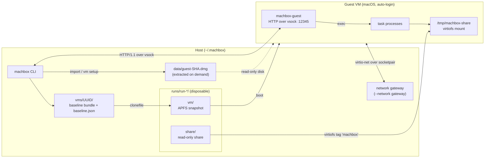

# Architecture

machbox runs macOS guests on Apple's `Virtualization.framework`. The core does four things:

- **Baseline management**: import a VirtualBuddy VM once, keep it in machbox's own bundle format.
- **Disposable runs**: every boot works on an APFS copy-on-write snapshot plus a read-only share, discarded afterwards; with `--attach`, after a terminal session in the guest.
- **Guest agent**: an HTTP API inside the guest, reached over virtio-vsock, that runs host-issued tasks.
- **Guest network**: none by default (a workflow may set its own); `--network gateway` goes through a host gateway that enforces an egress policy (`--egress`) and with `--pcap` saves every frame.



## Baselines

`machbox vm import <path.vbvm> <name>` reads the VirtualBuddy bundle once (`.vbdata/Config.plist`), then APFS-clones only the files machbox boots from into `~/.machbox/vms/<uuid>/`:

```
AuxiliaryStorage  HardwareModel  MachineIdentifier
Disk.img          config.json    # {"version":1,"cpu_count":…,"memory_size":…}
```

Once setup succeeds, `baseline.json` next to them records the baseline: name, guest OS, agent version and features. A directory without one, an import in progress or an interrupted one, is not a baseline. Record writes take a lock (`vms/.records.lock`) so names stay unique. Versions before this one kept records in `~/.machbox/machbox.sqlite`; the first command that reads baselines moves them into `baseline.json` files with macOS's `sqlite3` and renames the database to `machbox.sqlite.migrated`.

`vm duplicate` clones a baseline the same way, keeping its machine identity.

Commands coordinate through a `flock` on the baseline directory. `vm import` and `vm setup` hold it exclusively until the record is saved, and `vm remove` while it deletes; copying it (a run's snapshot, `vm duplicate`) holds it shared, only while copying. So copies go on together, but never of a baseline mid-write or mid-removal. Nothing waits: a command that finds a conflicting lock fails at once, since setup can take an hour.

Booting never reads VirtualBuddy metadata again. Baselines imported by old versions (a whole `.vbvm` copy, without `config.json`) are refused: remove them and import again.

Import and `vm setup` boot the baseline with a GUI and `guest.dmg` attached. The user runs Machbox Setup from it. Until the window closes, the host has the agent check the guest every few seconds (`GET /v1/check`); the baseline is ready once a compatible `AgentVersion` answers with automatic login on. The DMG is embedded in the binary and extracted to `data/guest-<sha256[:12]>.dmg` only when needed, atomically and read-only.

When the window closes, the host records the guest's OS version and the baseline's **features** from the last ready check: `agent`, `autologin`, and whichever of `rosetta`, `clt`, `ssh`, `full-disk-access` are in place, plus `sip-disabled` when SIP is off (`agent.Features`). Only import and setup change a baseline, so the record stays accurate. Plugins that need SIP off require `sip: disabled`, plugins that need tools require `features`, and baselines are chosen by those records before boot; after boot, SIP is confirmed against the live guest.

## Runs

A run (`internal/vm.Run`) owns one directory, `~/.machbox/runs/run-*/`:

| Path | Purpose |
|------|---------|
| `vm/` | clones of the baseline's writable files; the baseline itself is never modified |
| `share/` | host files exposed to the guest read-only via virtiofs (`agent.ShareTag`) |
| `.lock` | exclusive `flock` held for the run's lifetime |

`Close` removes the directory. Runs whose owner died (lock acquirable) are swept by the next `NewRun`.

## Guest agent

`machbox-guest` is a LaunchDaemon in the guest, listening on vsock port `12345`. The host dials through `VZVirtioSocketDevice`; requests are plain HTTP/1.1:

| Endpoint | Description |
|----------|-------------|
| `GET /v1/info` | OS, agent user, SIP state, `agent_version`, and the console user once their desktop is up |
| `GET /v1/check` | what is in place (`agent.CheckReport`); also written to `agent.CheckFile` for Machbox Setup |
| `POST /v1/workdir` | mount the share and create a writable work dir |
| `POST /v1/exec` | run a task to completion; JSON result |
| `POST /v1/exec/stream` | stream stdout as a chunked body; exit status in `X-Task-Error` / `X-Task-Timed-Out` trailers |
| `GET /v1/files?root=&path=` | read a regular file at `path` inside `root`, opened through `os.Root` (no `..` or symlink escape) |
| `POST /v1/ssh` | with `Upgrade: machbox-ssh`: after the `101`, the connection carries a TCP stream to the guest's sshd (`127.0.0.1:22`), for `machbox run --attach` without a guest network |

Cancelling a request kills the task in the guest. A stream that hits its timeout ends normally with the output collected so far. Host and guest share `AgentVersion`; a mismatch requires `machbox vm setup`.

Machbox Setup installs it. The SwiftUI app on the guest disk compares its bundled `machbox-guest` with the installed one and, when they differ, asks for the user's password and runs its `install.sh` as root through `sudo`: it copies the agent and its launchd plist, restarts it, and turns on automatic login, which needs the password itself. The script runs once and exits, so no privileged interface stays in the baseline, where a sample running as the user could reach it. The password goes over stdin, one line for `sudo` and one for the script.

Everything else is the user's to set up; Machbox only checks it.

## Plugins and jobs

A plugin is a directory with a `plugin.yml` and the command-line tools its workflows run **inside the guest**. `machbox run [flags] <plugin> <workflow> [inputs...]` executes one workflow as a job; `<plugin>` is a plugin directory or an installed plugin (see below). Abridged from `testdata/plugins/demo`, a working example with sh-only tools:

```yaml
manifest_version: 1         # plugin contract version (plugin.ManifestVersion)
name: demo
version: 0.1.0
requires:                   # checked against the baseline record before boot, and the live guest after
  macos: ">=13.0"           # comma-separated constraints: >= <= == > <
  sip: disabled             # disabled | enabled | omitted (any)
  # features: [rosetta, clt] # baseline features, see below; omitted (any)
workflows:
  analyze:
    inputs:                 # declaration order = positional argument order (booleans excluded)
      sample:   { type: file, required: true }   # file: read-only in the guest
      duration: { default: "10" }                # string (default type)
      mode:     { values: [fast, slow], default: fast }  # values: the only ones accepted
      verbose:  { type: boolean }                # "true" or "false" (default); a bare --verbose sets it
    requires: { features: [clt] }                # adds to the plugin's; sip here wins
    env:                    # every step; a step's env overrides it; values are templates
      DEMO_DATA: "${{ plugin_dir }}/data"
    steps:
      - id: info
        run: [tools/info, -o, "${{ output }}", "${{ inputs.sample }}"]
        output: info.json               # copied back to the job directory
      - id: run
        run: [tools/run, -o, "${{ output }}", -d, "${{ inputs.duration }}", "${{ inputs.sample }}"]
        output: run.jsonl
        timeout: 5m                     # default 10m; a timeout fails the step
        continue_on_error: true         # a failure does not fail the job
      - id: report
        when: always                    # success (default) | failure | always
        run: [tools/report, -o, "${{ output }}", "${{ steps.info.output }}", "${{ steps.run.output }}"]
        output: report/report.json
  explore:
    inputs:
      sample: { type: file, required: true }
    attach: [claude]        # after the steps, a session running claude (true: the login shell); --attach=false skips it
    steps:
      - id: info
        run: [tools/info, -o, "${{ output }}", "${{ inputs.sample }}"]
        output: info.json
```

Templates only substitute: `${{ inputs.<name> }}`, `${{ output }}`, `${{ steps.<id>.output }}` and `${{ steps.<id>.status }}` (an earlier step; `succeeded`, `failed`, `timed_out` or `skipped`), `${{ plugin_dir }}`. A command with a slash (`tools/x`) is resolved in the plugin directory; a bare name in the guest `PATH` (the agent's includes Homebrew and `/usr/local/bin`; an `env` PATH replaces it). Only the command is resolved this way: a relative path in an argument is relative to the workdir, so pass plugin files as `${{ plugin_dir }}/<path>`, e.g. `run: [bash, "${{ plugin_dir }}/scripts/x.sh"]`.

Before the first step, a job waits up to 5 minutes for the baseline's automatic login (the agent starts earlier, at the login window). Steps run as root, like the agent. Running the sample as the logged-in user (baselines log in automatically, see [Environment Setup](./environment-setup.md)) is up to the plugin: its root tools drop privileges when they launch the sample. Host safety never relies on that.

Once a sample runs, it controls the guest, agent included, so the host trusts nothing the guest sends to be small or timely: it enforces every timeout itself (plus a 30 s grace), caps step logs at 64 MiB and outputs at 512 MiB, and strips control characters from guest error text before storing or printing it.

In the guest, the plugin directory and file inputs are on the read-only share (`plugin/`, `inputs/<input>/<file name>`). `${{ inputs.sample }}` is the absolute path of that file on the share; a tool that needs to change it (clear its attributes, make it executable, unpack it in place) copies it into the workdir first. Every step runs with the same writable workdir as cwd. The guest never writes to the host: after each step the host pulls its declared output through `GET /v1/files` (capped at `job.MaxOutputSize`).

A job's VM stops once its steps are done, also with `--gui`, unless the run attaches a session (`--attach` or the workflow's `attach`). Then `job.json` gets the workflow's result and the job directory is logged, and the terminal is logged in to the guest: the console user, in the workdir (given to them first), running the workflow's command in a login shell, or the login shell itself. The VM is discarded when the session ends: the command exits, `~.` disconnects, the window is closed, the guest shuts down, or machbox gets SIGHUP or SIGTERM. A failed job still gets its session; the exit status is the job's. A workflow with `attach` may have no steps: the session is then the workflow (file inputs stay on the share), and `--attach=false` cannot run it. `caffeinate` keeps the host awake while a run's VM is up.

The session is the host's `/usr/bin/ssh`, so OpenSSH handles the terminal (raw mode, resizing, Ctrl-C to the guest). Its `ProxyCommand` (`nc -U`) reaches a unix socket in the run directory that machbox connects to the agent's `POST /v1/ssh`, which carries the stream to the guest's sshd over vsock: the guest needs no network, but the baseline needs Remote Login (`ssh`). Each run makes an ed25519 key, appended to the console user's `authorized_keys` in the snapshot only, and pins the host key it reads from the guest. ssh runs with `-F /dev/null`, sends only the locale (`LANG`, `LC_*`) and forwards nothing (no agent, X11 or ports) into a guest a sample may control; the console user name the guest reports is checked before it becomes an ssh argument. machbox refuses to attach before boot without a terminal on stdin and stdout, and logs to the job's `machbox.log` while ssh owns the terminal.

On the host, a job keeps only `~/.machbox/jobs/<id>/`:

| Path | Purpose |
|------|---------|
| `job.json` | plugin, inputs, baseline, guest info, status/error/timing of every step |
| `logs/<step>.log` | step stdout and stderr |
| `outputs/<output>` | each step's output, including partial output of a failed step |
| `network.pcap` | with `--pcap`: every guest frame, refused ones included, captured on the host |
| `machbox.log` | with `--attach`: machbox's log during the session |

Installed plugins ([usage](./plugins.md)) live in `~/.machbox/plugins/<owner>/<repo>/`: the repository, not the manifest `name`, identifies a plugin, so two plugins sharing a name never replace each other. `plugin install` takes a GitHub release's `.tar.gz` (`<repo>.tar.gz` if there are several) with `plugin.yml` at its root or in its only directory. It checks GitHub's SHA-256 digest of the asset when GitHub reports one, accepts only regular files and directories, and records the tag in `.machbox-source.json`; `plugin update` reinstalls when the latest tag differs, swapping the directory in one rename. `GITHUB_TOKEN`, if set, authenticates the API requests.

`internal/job` tests run the demo plugin's workflows against a loopback agent.

## Network

The network carries the guest's traffic; with `gateway`, the egress policy decides what it reaches. Each comes from `machbox run --network` / `--egress`, else the workflow's `network` / `egress` (logged when they apply), else `none`. A workflow's `egress` goes with its `network`: `--network` alone means egress `none`.

| Network | |
|---------|-|
| `none` | no network device |
| `nat` | vz NAT (vmnet): the guest reaches whatever the host can, its LAN included; the system forwards the traffic, so no policy applies and it cannot be captured |
| `gateway` | user-mode gateway on the host, under its egress policy; `--pcap` saves every frame |

| Egress (`gateway` only) | The guest reaches |
|--------|-------------------|
| `none` | nothing beyond the gateway itself (below) |
| `public` | public addresses |
| `all` | whatever the host can, its LAN included, but not the host itself |

The gateway (`pkg/vm/gateway`) attaches the guest to a gvisor-tap-vsock stack over a datagram socketpair (`VZFileHandleNetworkDeviceAttachment`); `Run.Boot` owns its lifetime. The stack's forwarders dial whatever address a packet is for, so a relay between the VM and the stack checks every guest frame first. Every policy drops frames for loopback, multicast, broadcast, `0.0.0.0/8` (which reaches the host's loopback on macOS) and the host's own interface addresses, re-read every 5 s: the gateway dials from the host, so a connection to one of them would go over loopback, past the host's firewall. `public` also drops those for:

- private addresses (10/8, 172.16/12, 192.168/16, fc00::/7), the guest subnet (192.168.127.0/24) included;
- link-local (169.254/16, fe80::/10, cloud metadata included);
- shared address space (100.64/10): carrier-grade NAT, and the peers of Tailscale and similar overlay VPNs.

With `all`, the LAN is reachable only if the app machbox runs in (Terminal, an IDE…) has macOS's Local Network permission; otherwise the guest's connections to it are refused.

On the gateway itself (192.168.127.1), under every policy, the guest reaches only DHCP, DNS and the [AI proxy](#ai-proxy), if any. DNS answers `machbox.internal` itself when there is a proxy; with `none` it answers no other name, so no query reaches the host's resolver (a way out, by DNS tunnelling); otherwise the host's resolver answers, so with `public` internal names resolve but their addresses stay unreachable. IPv6 is not routed. Refused frames are dropped silently, so a refused connection times out in the guest rather than failing fast; each refused unicast destination is logged once (up to 64); multicast and broadcast, routine OS chatter, are dropped without a log.

With `--pcap`, every frame, refused ones included, goes to `network.pcap` in the job directory, written by the host, never pulled from the guest.

`testdata/plugins/demo`'s `network` and `ai` workflows check a real guest: their `probe` step records what each URL returned (`probe.jsonl`).

### AI proxy

A workflow with `ai_proxy` lets the guest's AI agents (Claude Code, Codex, Gemini CLI…) use an API key that stays on the host:

```yaml
workflows:
  explore:
    network: gateway        # egress none: the guest reaches only the proxy
    ai_proxy:
      upstream: https://api.anthropic.com   # base URL; the request's path is appended
      key_env: ANTHROPIC_API_KEY            # host environment variable, read when the run starts
    attach: [claude]
```

The gateway's DNS then answers `machbox.internal` with the gateway's address, where port 80 serves plain HTTP (`pkg/vm/gateway.Proxy`). Each request goes to `upstream` plus its path and query, from the host (`HTTPS_PROXY` applies), with the guest's credential replaced by the key in the same place, so every client keeps its provider's scheme: `Authorization: Bearer`, `x-api-key` (Anthropic), `x-goog-api-key` or a `key` query parameter (Gemini); a request with none gets `Authorization: Bearer`. The guest holds only a placeholder, so the key is neither in the guest nor in `network.pcap`. Responses are flushed as they arrive, so SSE streams.

- `ai_proxy` needs `network: gateway` (and `--network gateway`, if given), with any egress.
- `key_env` names a variable, never holds the key, and must be set when the run starts. With it, `upstream` must be `https` unless on the host's loopback (`localhost`, `127.0.0.1`, `[::1]`). Without it, the guest's credentials pass unchanged.
- The proxy connects only to `upstream`, wherever it is, regardless of the egress policy: the host's loopback (e.g. a model server at `http://127.0.0.1:11434`) and the LAN included. The guest chooses the path, never the host, and redirects are passed back, not followed.
- Only API keys work: subscription logins (Claude Pro/Max, ChatGPT, Google sign-in) are OAuth flows tied to the provider's own endpoints.
- A plugin's `ai_proxy` decides which host variable goes where, and which host service the guest reaches: check it in a plugin you did not write.

machbox does not configure the guest's agents: point them at `http://machbox.internal` in the baseline ([Environment Setup](./environment-setup.md#ai-agents)), or in the plugin (`env` for steps, an `attach` command such as `[env, ANTHROPIC_BASE_URL=http://machbox.internal, ANTHROPIC_API_KEY=machbox, claude]`).

`vm import` and `vm setup` always boot with `nat`.

## Packages

| Package | Role |
|---------|------|
| `cmd` | CLI: `vm import/list/rename/duplicate/setup/remove`, `plugin install/list/update/remove`, `run`, `job prune` |
| `internal/vm` | baseline lifecycle (import, setup, duplicate, resolve), disposable runs |
| `internal/agent` | guest agent HTTP API: server (guest) and client (host) |
| `internal/plugin` | `plugin.yml` loading, validation, templates, requirements, workflow arguments |
| `internal/plugin/store` | installed plugins: GitHub release download, verification, extraction |
| `internal/job` | job directory and record, step execution in the guest, output collection |
| `internal/assets` | `~/.machbox` layout, embedded guest DMG |
| `internal/db` | baseline records (`baseline.json`), migration from the old SQLite database |
| `internal/logger` | logrus setup for `--log-level`, `--log-json` |
| `pkg/vm` | VM instance: start/stop, state, GUI, vsock connect |
| `pkg/vm/config` | baseline bundle format, VirtualBuddy import, snapshot, `Virtualization.framework` configuration |
| `pkg/vm/gateway` | `--network gateway`: gvisor-tap-vsock stack, egress policy, DNS, pcap capture, AI proxy |
| `pkg/vsock` | guest-side AF_VSOCK listener |
| `guest-agent` | `machbox-guest` daemon and its `check`, `app/` Machbox Setup and its `install.sh` |
