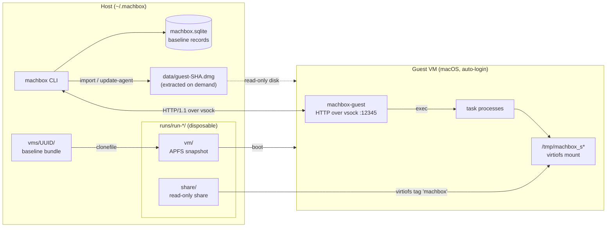

# Architecture

machbox runs macOS guests on Apple's `Virtualization.framework`. The core does three things:

- **Baseline management**: import a VirtualBuddy VM once, keep it in machbox's own bundle format.
- **Disposable runs**: every boot works on an APFS copy-on-write snapshot plus a read-only share, discarded afterwards.
- **Guest agent**: an HTTP API inside the guest, reached over virtio-vsock, that runs host-issued tasks.



## Baselines

`machbox vm import <path.vbvm> <name>` reads the VirtualBuddy bundle once (`.vbdata/Config.plist`), then APFS-clones only the files machbox boots from into `~/.machbox/vms/<uuid>/`:

```
AuxiliaryStorage  HardwareModel  MachineIdentifier
Disk.img          config.json    # {"version":1,"cpu_count":…,"memory_size":…}
```

Booting never reads VirtualBuddy metadata again. Baselines imported by older versions (a whole `.vbvm` copy) are migrated in place on first load.

Import and `vm update-agent` boot the baseline with a GUI and `guest.dmg` attached. The user installs `machbox-guest.pkg` from it; the host polls the agent until a compatible `AgentVersion` answers, then records the guest's OS version and SIP state. SIP may be on or off; plugins that need it off require `sip: disabled`, and baselines are chosen by those records before boot. The DMG is embedded in the binary and extracted to `data/guest-<sha256[:12]>.dmg` only when needed, atomically and read-only.

## Runs

A run (`internal/vm.Run`) owns one directory, `~/.machbox/runs/run-*/`:

| Path | Purpose |
|------|---------|
| `vm/` | clones of the baseline's writable files; the baseline itself is never modified |
| `share/` | host files exposed to the guest read-only via virtiofs (`agent.ShareTag`) |
| `.lock` | exclusive `flock` held for the run's lifetime |

`Close` removes the directory. Runs whose owner died (lock acquirable) are swept by the next `NewRun`.

## Guest agent

`machbox-guest` is a LaunchDaemon in the guest, listening on vsock port `12345`. The host dials through `VZVirtioSocketDevice`; requests are plain HTTP/1.1:

| Endpoint | Description |
|----------|-------------|
| `GET /v1/info` | OS, agent user, SIP state, `agent_version`, and the console user once their desktop is up |
| `POST /v1/workdir` | mount the share and create a writable work dir |
| `POST /v1/exec` | run a task to completion; JSON result |
| `POST /v1/exec/stream` | stream stdout as a chunked body; exit status in `X-Task-Error` / `X-Task-Timed-Out` trailers |
| `GET /v1/files?root=&path=` | read a regular file at `path` inside `root`, opened through `os.Root` (no `..` or symlink escape) |

Cancelling a request kills the task in the guest. A stream that hits its timeout ends normally with the output collected so far. Host and guest share `AgentVersion`; a mismatch requires `machbox vm update-agent`.

## Plugins and jobs

A plugin is a directory with a `plugin.yml` and the command-line tools its workflows run **inside the guest**. `machbox run [flags] <plugin-dir> <workflow> [inputs...]` executes one workflow as a job:

```yaml
manifest_version: 1         # plugin contract version (plugin.ManifestVersion)
name: malware
version: 0.1.0
requires:                   # checked against the baseline record before boot, and the live guest after
  macos: ">=14.0"           # comma-separated constraints: >= <= == > <
  sip: disabled             # disabled | enabled | omitted (any)
workflows:
  analyze:
    inputs:                 # declaration order = positional argument order
      sample:  { type: file, required: true }   # file: copied into the guest workdir
      timeout: { default: 5m }                  # string (default type)
    env:                    # every step; a step's env overrides it; values are templates
      PYTHONPATH: "${{ plugin_dir }}/lib"
    steps:
      - id: static
        run: [tools/statictool, -o, "${{ output }}", "${{ inputs.sample }}"]
        output: static.json             # copied back to the job directory
      - id: dynamic
        run: [tools/dynamictool, run, -o, "${{ output }}", "${{ inputs.sample }}"]
        output: dynamic.jsonl
        timeout: 10m                    # default 10m; a timeout fails the step
        continue_on_error: true         # a failure does not fail the job
      - id: report
        when: always                    # success (default) | failure | always
        run: [tools/report, -o, "${{ output }}", "${{ steps.static.output }}", "${{ steps.dynamic.output }}"]
        output: report.json
```

Templates only substitute: `${{ inputs.<name> }}`, `${{ output }}`, `${{ steps.<id>.output }}` (an earlier step), `${{ plugin_dir }}`. A command with a slash (`tools/x`) is resolved in the plugin directory; a bare name in the guest `PATH` (the agent's includes Homebrew and `/usr/local/bin`; an `env` PATH replaces it).

Before the first step, a job waits up to 5 minutes for the baseline's automatic login (the agent starts earlier, at the login window). Steps run as root, like the agent. Running the sample as the logged-in user (baselines log in automatically, see `environment-setup.md`) is up to the plugin: its root tools drop privileges when they launch the sample. Host safety never relies on that.

Once a sample runs, it controls the guest, agent included, so the host trusts nothing the guest sends to be small or timely: it enforces every timeout itself (plus a 30 s grace), caps step logs at 64 MiB and outputs at 512 MiB, and strips control characters from guest error text before storing or printing it.

In the guest, the plugin directory and file inputs are on the read-only share (`plugin/`, `inputs/<input>/<file name>`). Every step runs with the same writable workdir as cwd; file inputs are copied there first, so `${{ inputs.sample }}` is `inputs/sample/<file name>` relative to it. The guest never writes to the host: after each step the host pulls its declared output through `GET /v1/files` (capped at `job.MaxOutputSize`).

`docs/plugin.schema.json` describes the manifest for editors. Map it to `**/plugin.yml` (VS Code: `"yaml.schemas"` in settings) or start the file with `# yaml-language-server: $schema=<path to it>`; otherwise editors may apply SchemaStore's Bukkit `plugin.yml` schema and report a missing `main`.

`testdata/plugins/demo` is a working example (sh tools only); `internal/job` tests run its workflows against a loopback agent.

On the host, a job keeps only `~/.machbox/jobs/<id>/`:

| Path | Purpose |
|------|---------|
| `job.json` | plugin, inputs, baseline, guest info, status/error/timing of every step |
| `logs/<step>.log` | step stdout and stderr |
| `outputs/<output>` | each step's output, including partial output of a failed step |

## Packages

| Package | Role |
|---------|------|
| `cmd` | CLI: `vm import/list/rename/update-agent/remove`, `run` |
| `internal/vm` | baseline lifecycle (import, update-agent, resolve) and disposable runs |
| `internal/agent` | guest agent HTTP API: server (guest) and client (host) |
| `internal/plugin` | `plugin.yml` loading, validation, templates, requirements, workflow arguments |
| `internal/job` | job directory and record, step execution in the guest, output collection |
| `internal/assets` | `~/.machbox` layout, embedded guest DMG |
| `internal/db` | SQLite baseline records |
| `pkg/vm` | VM instance: start/stop, state, GUI, vsock connect |
| `pkg/vm/config` | baseline bundle format, VirtualBuddy import, snapshot, `Virtualization.framework` configuration |
| `pkg/vsock` | guest-side AF_VSOCK listener |
| `guest-agent` | `machbox-guest` daemon and `.pkg` packaging |
