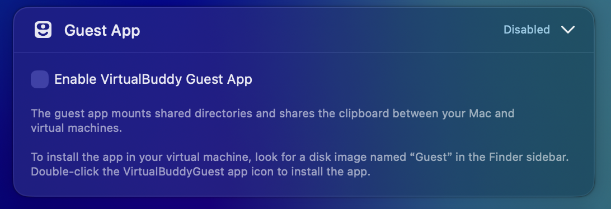
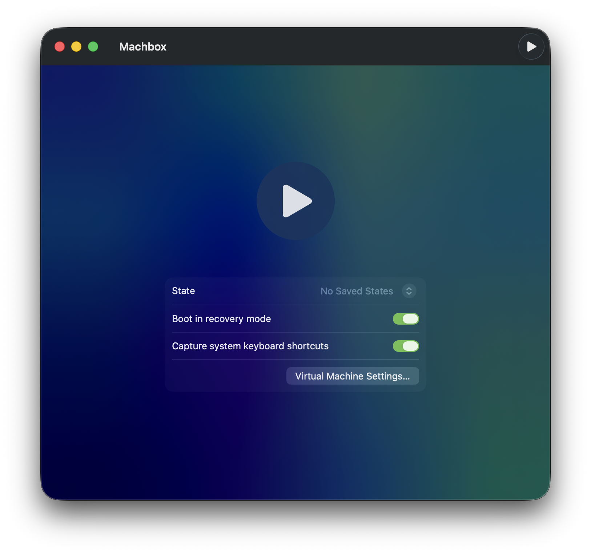

# Environment Setup

Only needs to be done once. After setup, the imported baseline can be reused for every run.

## Create a Base VM with VirtualBuddy

- Open [VirtualBuddy](https://github.com/insidegui/VirtualBuddy) and create a new macOS VM.

    - Optional (during creation, uncheck "Enable VirtualBuddy Guest App")

      

3. Complete the macOS setup inside the VM (region, account, etc.).

> **Keep the baseline free of anything personal.** Every run starts from it, so
> whatever it holds is readable by the code you run, which gets root.
>
> - Create a local account with a password you use nowhere else: automatic login
>   (below) stores it in the guest in recoverable form.
> - Skip Apple ID / iCloud sign-in, and do not sign in to any other account or
>   service inside the VM.

## Turn FileVault Off in the Guest VM

Samples run as the logged-in user in a real GUI session, so the guest has to log
in automatically on every boot (runs are headless). macOS refuses automatic login
while FileVault is on: turn it off in **System Settings → Privacy & Security →
FileVault**. Installing `machbox-guest.pkg` then enables automatic login (below).

## Disable SIP in the Guest VM (if your plugins need it)

Plugins state whether they need SIP (System Integrity Protection) off, e.g. for
EndpointSecurity or DTrace (`requires: {sip: disabled}` in `plugin.yml`); `machbox
vm list` shows each baseline's state, and `machbox run` picks a baseline that fits.
Keeping SIP on is more realistic: some software checks `csrutil status` and
behaves differently when SIP is off. You can keep one baseline of each kind.

1. In VirtualBuddy, enable **Boot in recovery mode** for the VM.



2. Start the VM and open **Utilities → Terminal** from the menu bar.

3. Run:

   ```bash
   csrutil disable
   ```

4. Restart the VM normally.

## Install the Machbox Guest Agent

On the host, run the command below. It opens the VM window:

```bash
machbox vm import /path/to/your_Machbox.vbvm <name>
```

In the VM window:

1. Open Finder and select `MachboxGuest` from the sidebar.
2. Install `machbox-guest.pkg`.
3. When asked, enter your account password to enable automatic login. macOS needs
   it to log in by itself; it is checked and stored by macOS only. If you skip
   this, set **System Settings → Users & Groups → Automatically log in as**
   yourself, or reinstall the package later.
4. Wait for the installation to finish (Xcode Command Line Tools will be installed silently).
5. After the checks pass, close the VM window to finish the import.

## Update the Guest Agent on an Imported Baseline

When a new Machbox release ships an updated `machbox-guest.pkg` (for example after
a guest agent version change), reinstall it on an existing baseline without
re-importing the VirtualBuddy bundle:

```bash
machbox vm update-agent <uuid-or-name>
```

In the VM window:

1. Open Finder and select `MachboxGuest` from the sidebar.
2. Reinstall `machbox-guest.pkg` (overwrite the previous install).
3. After the checks pass, close the VM window to finish the update.

`machbox vm list` shows the recorded agent version in the `AGENT` column.
