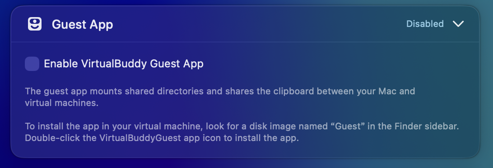
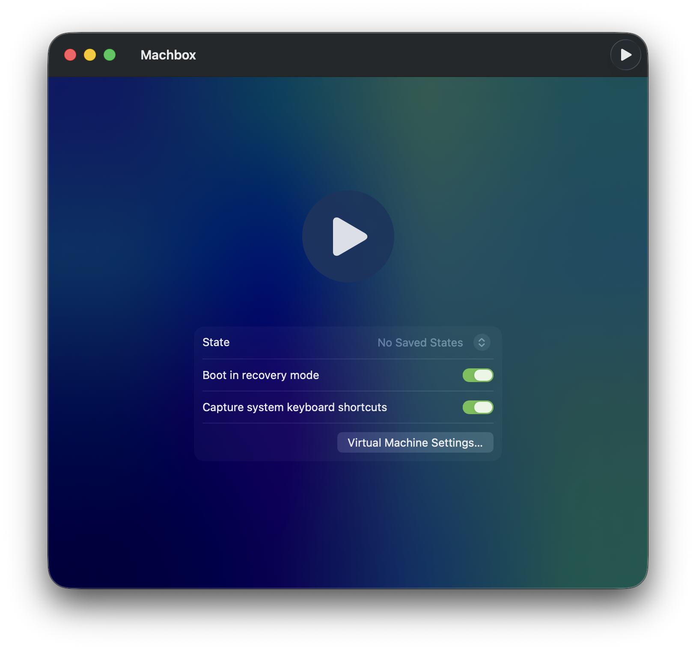

# Environment Setup

Only needs to be done once. After setup, the imported baseline can be reused for every run.

## Create a Base VM with VirtualBuddy

- Open [VirtualBuddy](https://github.com/insidegui/VirtualBuddy) and create a new macOS VM.

    - Optional (during creation, uncheck "Enable VirtualBuddy Guest App")

      

3. Complete the macOS setup inside the VM (region, account, etc.).

> **Keep the baseline free of anything personal.** Every run starts from it, so
> whatever it holds is readable by the code you run, which gets root.
>
> - Create a local account with a password you use nowhere else: automatic login
>   (below) stores it in the guest in recoverable form.
> - Skip Apple ID / iCloud sign-in, and do not sign in to any other account or
>   service inside the VM.

## Turn FileVault Off in the Guest VM

Samples run as the logged-in user in a real GUI session, so the guest has to log
in automatically on every boot (runs are headless). macOS refuses automatic login
while FileVault is on: turn it off in **System Settings → Privacy & Security →
FileVault**. Machbox Setup then enables automatic login (below).

## Disable SIP in the Guest VM (if your plugins need it)

Plugins state whether they need SIP (System Integrity Protection) off, e.g. for
EndpointSecurity or DTrace (`requires: {sip: disabled}` in `plugin.yml`); `machbox
vm list` shows `sip-disabled` in the `FEATURES` column of baselines that have it off,
and `machbox run` picks a baseline that fits.
Keeping SIP on is more realistic: some software checks `csrutil status` and
behaves differently when SIP is off. You can keep one baseline of each kind.

1. In VirtualBuddy, enable **Boot in recovery mode** for the VM.



2. Start the VM and open **Utilities → Terminal** from the menu bar.

3. Run:

   ```bash
   csrutil disable
   ```

4. Restart the VM normally.

## Run Machbox Setup

On the host, run the command below. It opens the VM window:

```bash
machbox vm import /path/to/your_Machbox.vbvm <name>
```

In the VM window:

1. Open Finder, select `MachboxGuest` from the sidebar and open **Machbox Setup**.
   It runs from that disk and leaves no app in the baseline.
2. Press **Install Agent…** and enter your account password. Machbox Setup installs the
   guest agent as root and turns on automatic login: macOS needs the password to log
   in by itself, and stores it in recoverable form. With FileVault on, automatic login
   is impossible and Machbox Setup says so; turn FileVault off (see above) and install
   again.
3. When the host logs that setup checks passed, the baseline is usable. Set up what
   your plugins need from the optional list (below), then close the VM window to
   finish the import.

> Everything in a baseline is visible to, and usable by, what you run in it. Set up
> only what your plugins need, or keep separate baselines for separate purposes.

### Optional Items

Machbox checks these and never installs them; each has a button to start on it:

| Item | Feature | How |
|------|---------|-----|
| Remote Login (SSH) | `ssh` | System Settings → General → Sharing → Remote Login |
| Xcode Command Line Tools | `clt` | Apple's installer (`xcode-select --install`) |
| Rosetta 2 | `rosetta` | `softwareupdate --install-rosetta`, which asks for your password |

The host checks the guest every few seconds while the window is open, with
`machbox-guest check` run by the agent, and records what was in place when the
window closed. Remote Login needs a network, which only setup always has: runs have
none unless `--network` or the workflow provides it.

## Update the Agent or Change the Tools of a Baseline

To install a new agent after a Machbox release, or set up more later, run:

```bash
machbox vm setup <uuid-or-name>
```

`machbox vm update-agent` is an alias. In the VM window, open Machbox Setup again
as above: it shows **Update Agent…** when the installed agent is another build, and asks
for the password again, which also refreshes automatic login.

`machbox vm import`, `machbox vm setup` and `machbox vm list` print each baseline's
agent version and its features: `agent`, `autologin`, the optional items in place
when the setup window closed, and `sip-disabled`. Plugins can require features (`requires: {features: [rosetta, clt]}`);
`machbox run` only picks baselines that have them. Baselines recorded by older
versions list only `sip-disabled`: run `machbox vm setup` once to record the rest.

